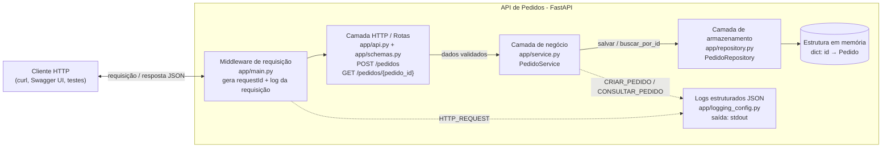

# API de Pedidos — CP5 Arquitetura Orientada a Serviço

API REST simples para gerenciamento de pedidos de um e-commerce: **criar pedido** e **consultar pedido por identificador**, com armazenamento em memória, documentação OpenAPI, teste automatizado e logs estruturados em JSON.

## Integrantes

| Nome | RM |
|------|----|
| Danilo Luz Rios | RM554791 |
| Lucca Natario do Vale | RM95688 |
| Thiago Feltrin Geraldes | RM555805 |

## Tecnologias

| Item | Escolha |
|------|---------|
| Linguagem | Python 3.10+ |
| Framework | FastAPI (servidor Uvicorn) |
| Validação / JSON | Pydantic |
| Persistência | Dicionário em memória (sem banco externo) |
| Testes | Pytest + TestClient do FastAPI |
| Logs | `logging` da biblioteca padrão com formatador JSON próprio |

## Estrutura do projeto

```
.
├── app/
│   ├── main.py             # Cria o app, middleware de requestId/log e tratamento de erros
│   ├── api.py              # Camada HTTP: rotas POST /pedidos e GET /pedidos/{pedido_id}
│   ├── schemas.py          # Contratos JSON de entrada e saída (Pydantic)
│   ├── service.py          # Camada de negócio: regras de criação e consulta
│   ├── repository.py       # Camada de armazenamento em memória
│   ├── domain.py           # Entidade Pedido e enum StatusPedido
│   └── logging_config.py   # Logs estruturados em JSON
├── tests/
│   ├── conftest.py         # Cliente de teste com repositório limpo a cada teste
│   └── test_pedidos.py     # Testes automatizados
├── docs/
│   ├── openapi.yaml        # Especificação OpenAPI 3.1 (YAML)
│   ├── openapi.json        # Especificação OpenAPI 3.1 (JSON)
│   ├── arquitetura.mmd     # Fonte do diagrama de arquitetura (Mermaid)
│   └── evidencias/         # Saídas reais de execução (testes, requisições e logs)
├── scripts/
│   └── exportar_openapi.py # Regenera docs/openapi.yaml e docs/openapi.json
├── pytest.ini              # Configuração do Pytest
└── requirements.txt
```

## 1. Arquitetura e System Design



A solução segue uma **arquitetura em camadas**: cada camada conversa apenas com a camada logo abaixo, então trocar o armazenamento em memória por um banco real exigiria mudar só o repositório.

| Componente | Responsabilidade |
|------------|------------------|
| **Cliente HTTP** | Quem consome a API (curl, Swagger UI, Postman ou os testes automatizados). Envia e recebe JSON. |
| **Middleware de requisição** (`main.py`) | Lê o header `X-Request-ID` ou gera um UUID, guarda esse `requestId` no contexto da requisição, devolve-o no header da resposta e registra um log por requisição (método, caminho, status e duração). Também converte erros de domínio em respostas HTTP (404 e 422) com corpo JSON padronizado. |
| **Camada HTTP / Rotas** (`api.py`, `schemas.py`) | Define os endpoints, os métodos HTTP e os status de resposta. Valida o JSON de entrada com Pydantic e converte a entidade em JSON de saída. Não contém regra de negócio. |
| **Camada de negócio** (`service.py`) | Regras do pedido: gera o identificador (UUID), define o status inicial `CRIADO` e a data de criação, e lança `PedidoNaoEncontradoError` quando o id não existe. Registra os logs das operações de negócio. |
| **Camada de armazenamento** (`repository.py`) | Guarda e busca pedidos em um dicionário em memória (`id → Pedido`), protegido por lock. Os dados somem ao reiniciar a aplicação, como pede o enunciado. |
| **Logs estruturados** (`logging_config.py`) | Formata cada log como uma linha JSON com `timestamp`, `level`, `operacao`, `message`, `requestId` e, quando houver, `pedidoId`. |

## 2. OpenAPI / Swagger

- Especificação no repositório: [`docs/openapi.yaml`](docs/openapi.yaml) (também em [`docs/openapi.json`](docs/openapi.json)).
- Com a API rodando: **Swagger UI** em http://localhost:8000/docs, ReDoc em http://localhost:8000/redoc e a especificação em http://localhost:8000/openapi.json.

| Operação | Método e caminho | Entrada | Respostas |
|----------|------------------|---------|-----------|
| Criar pedido | `POST /pedidos` | JSON com `cliente`, `descricao`, `valor` | `201 Created` (pedido + header `Location`) · `422 Unprocessable Content` (dados inválidos) |
| Consultar pedido | `GET /pedidos/{pedido_id}` | `pedido_id` no caminho | `200 OK` (pedido) · `404 Not Found` (pedido inexistente) |

Decisões de modelagem:
- `POST` na coleção `/pedidos` para criar e `GET` no recurso `/pedidos/{pedido_id}` para consultar, seguindo o padrão REST de coleção/recurso.
- `id`, `status` e `criadoEm` são definidos pelo servidor; o cliente envia apenas os dados do pedido.
- A criação retorna `201 Created` com o header `Location` apontando para o novo recurso.
- Erros usam sempre o mesmo formato JSON (`erro`, `mensagem`, `requestId`, `detalhes`).

Para regenerar a especificação após alterar a API: `python -m scripts.exportar_openapi`

## 3. Como executar a API

Pré-requisito: Python 3.10 ou superior.

```bash
# 1. Criar e ativar o ambiente virtual
python -m venv .venv

# Windows (PowerShell)
.venv\Scripts\Activate.ps1
# Windows (Git Bash)
source .venv/Scripts/activate
# Linux / macOS
source .venv/bin/activate

# 2. Instalar as dependências
pip install -r requirements.txt

# 3. Subir a API (http://localhost:8000)
uvicorn app.main:app --reload --no-access-log
```

> `--no-access-log` desliga o log de acesso em texto do Uvicorn, para que o terminal mostre apenas os logs JSON da aplicação.

## Exemplos de requisição e resposta

Saídas reais registradas em [`docs/evidencias/requisicoes.txt`](docs/evidencias/requisicoes.txt). A forma mais simples de testar é pelo Swagger UI (http://localhost:8000/docs → *Try it out*).

### Criar pedido — `201 Created`

```bash
curl -i -X POST http://localhost:8000/pedidos \
  -H "Content-Type: application/json" \
  -d '{"cliente":"Maria Silva","descricao":"1x Notebook Dell Inspiron 15","valor":4599.90}'
```

PowerShell:

```powershell
Invoke-RestMethod -Method Post -Uri http://localhost:8000/pedidos -ContentType "application/json" `
  -Body '{"cliente":"Maria Silva","descricao":"1x Notebook Dell Inspiron 15","valor":4599.90}'
```

Resposta:

```
HTTP/1.1 201 Created
location: /pedidos/35f1082e-38f9-4c8c-9e94-59330c43619b
x-request-id: f4b00883-7376-46d8-a08c-4df20a11643f
content-type: application/json
```
```json
{
  "id": "35f1082e-38f9-4c8c-9e94-59330c43619b",
  "cliente": "Maria Silva",
  "descricao": "1x Notebook Dell Inspiron 15",
  "valor": 4599.9,
  "status": "CRIADO",
  "criadoEm": "2026-10-22T00:37:01.740948Z"
}
```

### Consultar pedido existente — `200 OK`

```bash
curl -i http://localhost:8000/pedidos/35f1082e-38f9-4c8c-9e94-59330c43619b
```
```json
{
  "id": "35f1082e-38f9-4c8c-9e94-59330c43619b",
  "cliente": "Maria Silva",
  "descricao": "1x Notebook Dell Inspiron 15",
  "valor": 4599.9,
  "status": "CRIADO",
  "criadoEm": "2026-10-22T00:37:01.740948Z"
}
```

### Consultar pedido inexistente — `404 Not Found`

```bash
curl -i http://localhost:8000/pedidos/pedido-inexistente
```
```json
{
  "erro": "PEDIDO_NAO_ENCONTRADO",
  "mensagem": "Pedido 'pedido-inexistente' não encontrado",
  "requestId": "8e5bd332-2b98-4224-943a-da549160c654",
  "detalhes": null
}
```

### Criar pedido com dados inválidos — `422 Unprocessable Content`

```bash
curl -i -X POST http://localhost:8000/pedidos \
  -H "Content-Type: application/json" \
  -d '{"descricao":"Pedido sem cliente","valor":-10}'
```
```json
{
  "erro": "REQUISICAO_INVALIDA",
  "mensagem": "Dados de entrada inválidos",
  "requestId": "f691b729-abf0-4187-81cd-3956191c7f2f",
  "detalhes": [
    { "campo": "cliente", "mensagem": "Field required" },
    { "campo": "valor", "mensagem": "Input should be greater than 0" }
  ]
}
```

## 4. Teste automatizado

Os testes usam **Pytest** com o `TestClient` do FastAPI, que faz requisições HTTP reais contra a aplicação sem precisar subir o servidor. Cada teste recebe um repositório em memória novo (`tests/conftest.py`), então um teste não interfere no outro.

| Teste | O que verifica |
|-------|----------------|
| `test_criar_pedido_retorna_201_com_status_criado` | `POST /pedidos` retorna 201, os dados enviados, status `CRIADO` e header `Location` |
| `test_consultar_pedido_existente_retorna_200` | Um pedido criado pode ser consultado pelo id e volta igual |
| `test_consultar_pedido_inexistente_retorna_404` | Id inexistente retorna 404 com erro `PEDIDO_NAO_ENCONTRADO` e o mesmo `requestId` do header |
| `test_criar_pedido_com_valor_invalido_retorna_422` | Valor `0` é rejeitado com 422 apontando o campo `valor` |
| `test_criar_pedido_gera_log_estruturado_em_json` | A criação gera log JSON com `timestamp`, `level`, `message`, `requestId` e `pedidoId` |

### Como executar

Com o ambiente virtual ativado, na raiz do projeto:

```bash
python -m pytest -v
```

### Evidência da execução

Saída registrada em [`docs/evidencias/pytest-resultado.txt`](docs/evidencias/pytest-resultado.txt):

```
============================= test session starts ==============================
platform linux -- Python 3.13.16, pytest-9.1.1, pluggy-1.7.0 -- /usr/bin/python3
cachedir: .pytest_cache
rootdir: /home/claude/pedidos-api
plugins: platformdirs-4.12.3, anyio-4.15.1
collecting ... collected 5 items

tests/test_pedidos.py::test_criar_pedido_retorna_201_com_status_criado PASSED [ 20%]
tests/test_pedidos.py::test_consultar_pedido_existente_retorna_200 PASSED [ 40%]
tests/test_pedidos.py::test_consultar_pedido_inexistente_retorna_404 PASSED [ 60%]
tests/test_pedidos.py::test_criar_pedido_com_valor_invalido_retorna_422 PASSED [ 80%]
tests/test_pedidos.py::test_criar_pedido_gera_log_estruturado_em_json PASSED [100%]

============================== 5 passed in 0.06s ===============================
```

## 5. Observabilidade: logs estruturados

Todos os logs da aplicação saem no terminal (stdout), **um objeto JSON por linha**, com os campos:

| Campo | Descrição |
|-------|-----------|
| `timestamp` | Data e hora em UTC, formato ISO 8601 com milissegundos |
| `level` | Nível do log: `INFO`, `WARNING` ou `ERROR` |
| `operacao` | Operação registrada: `CRIAR_PEDIDO`, `CONSULTAR_PEDIDO`, `VALIDAR_REQUISICAO`, `HTTP_REQUEST`, `ERRO_INTERNO` |
| `message` | Mensagem descritiva |
| `requestId` | Identificador da requisição (o mesmo devolvido no header `X-Request-ID`) |
| `pedidoId` | Identificador do pedido, quando a operação envolve um pedido |
| `metodo`, `caminho`, `statusCode`, `duracaoMs` | Presentes no log `HTTP_REQUEST`, emitido ao final de cada requisição |

Como o `requestId` aparece em todos os logs da mesma requisição e também na resposta, é possível ligar uma resposta recebida pelo cliente aos registros do servidor.

### Evidência dos logs

Logs gerados pela API durante as requisições de exemplo acima, registrados em [`docs/evidencias/logs-estruturados.jsonl`](docs/evidencias/logs-estruturados.jsonl):

```json
{"timestamp": "2026-10-22T00:37:01.740Z", "level": "INFO", "operacao": "CRIAR_PEDIDO", "message": "Pedido criado com sucesso", "requestId": "f4b00883-7376-46d8-a08c-4df20a11643f", "pedidoId": "35f1082e-38f9-4c8c-9e94-59330c43619b"}
{"timestamp": "2026-10-22T00:37:01.741Z", "level": "INFO", "operacao": "HTTP_REQUEST", "message": "Requisição HTTP concluída", "requestId": "f4b00883-7376-46d8-a08c-4df20a11643f", "metodo": "POST", "caminho": "/pedidos", "statusCode": 201, "duracaoMs": 5.19}
{"timestamp": "2026-10-22T00:37:01.777Z", "level": "INFO", "operacao": "CONSULTAR_PEDIDO", "message": "Pedido consultado com sucesso", "requestId": "652cf20d-b7d1-48a5-a7e6-6353d1177f68", "pedidoId": "35f1082e-38f9-4c8c-9e94-59330c43619b"}
{"timestamp": "2026-10-22T00:37:01.778Z", "level": "INFO", "operacao": "HTTP_REQUEST", "message": "Requisição HTTP concluída", "requestId": "652cf20d-b7d1-48a5-a7e6-6353d1177f68", "metodo": "GET", "caminho": "/pedidos/35f1082e-38f9-4c8c-9e94-59330c43619b", "statusCode": 200, "duracaoMs": 1.55}
{"timestamp": "2026-10-22T00:37:01.785Z", "level": "WARNING", "operacao": "CONSULTAR_PEDIDO", "message": "Pedido não encontrado", "requestId": "8e5bd332-2b98-4224-943a-da549160c654", "pedidoId": "pedido-inexistente"}
{"timestamp": "2026-10-22T00:37:01.785Z", "level": "INFO", "operacao": "HTTP_REQUEST", "message": "Requisição HTTP concluída", "requestId": "8e5bd332-2b98-4224-943a-da549160c654", "metodo": "GET", "caminho": "/pedidos/pedido-inexistente", "statusCode": 404, "duracaoMs": 1.0}
{"timestamp": "2026-10-22T00:37:01.792Z", "level": "WARNING", "operacao": "VALIDAR_REQUISICAO", "message": "Requisição com dados inválidos", "requestId": "f691b729-abf0-4187-81cd-3956191c7f2f", "detalhes": [{"campo": "cliente", "mensagem": "Field required"}, {"campo": "valor", "mensagem": "Input should be greater than 0"}]}
{"timestamp": "2026-10-22T00:37:01.792Z", "level": "INFO", "operacao": "HTTP_REQUEST", "message": "Requisição HTTP concluída", "requestId": "f691b729-abf0-4187-81cd-3956191c7f2f", "metodo": "POST", "caminho": "/pedidos", "statusCode": 422, "duracaoMs": 1.25}
```

Repare que o `requestId` `f4b00883-...` do primeiro log é o mesmo do header `x-request-id` da resposta do `POST` mostrada na seção de exemplos.
